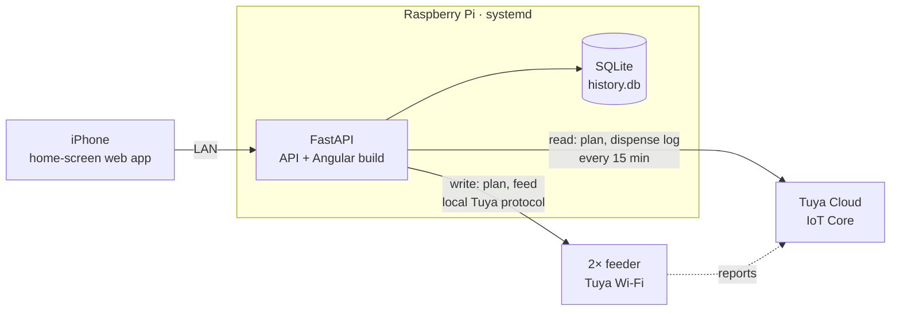

<div align="center">

# Schnauz-Buffet 🐾

**A self-hosted control center for two Tuya-based cat feeders: feeding schedules, consumption analysis, food costs and supply planning.**

Reverse-engineered from the vendor app, controlled locally over Wi-Fi, running on a Raspberry Pi at home.


</div>

---

## About

We have three cats and two Oneisall PFD-002 PRO IR feeders. The vendor app can set a schedule, but it can't answer the questions we actually had: *Did they get fed today? How much do they eat? What does the food cost, and when do we need to order more?*

Schnauz-Buffet answers those questions. It is a mobile-first web app (installed on the iPhone home screen) backed by a small FastAPI service. The service talks to the feeders **directly over the local network**, and uses the Tuya cloud only where the devices give it no choice.

The app runs only in the home network. The UI is in German, and the page names below are given as they appear in the app.

## Features

### Today (`/`)
- Both feeding schedules side by side, with the **next meal highlighted**
- **Skip a meal** for today or tomorrow. It is switched back on automatically afterwards.
- **Feed one portion now** (tap twice to confirm)
- Portions and grams per day and per bowl, a reminder when food is running low, and a cat gallery

### Feeding schedule (`/plan`)
- Add, edit and delete feeding times, optionally for both feeders at once

### Consumption analysis (`/analyse`)
- Grams per day over 7, 14 or 30 days, with a target line from the current plan
- Scheduled, **skipped** and **manually fed** portions, detected automatically from the device log
- Daily rhythm of all dispenses and a table per day

### Food costs (`/kosten`)
- Cost per day, month, year and cat, and how long a pack lasts
- Cumulative cost chart with a 30-day forecast

### Food orders (`/bestellungen`)
- Record stock counts and orders, and confirm deliveries
- **Projection** of when food runs out and the latest day to order, with a reminder 7 days ahead

## Architecture



### Engineering highlights

| Area | Approach |
|---|---|
| **Reverse engineering** | I captured the vendor app with mitmproxy. Its own backend only serves extras, while device control runs over Tuya MQTT with certificate pinning. So the feeders were moved to the Smart Life app, which gives access to their Tuya local keys. |
| **Hybrid local/cloud control** | The feeders don't report their meal plan (data point 1) locally. Reads go through the Tuya cloud and are cached for 5 minutes. All writes, like editing the plan, skipping a meal or feeding, go **directly to the device** over the LAN with `tinytuya`. |
| **Binary protocol** | The meal plan is a raw data point with 5 bytes per meal: `[weekday bitmask, hour, minute, portions, enabled]`. `feeder.py` encodes and decodes it and doubles as a CLI. |
| **Skipping meals** | The device has no "skip once" option. Skipping disables the meal, and a background task re-enables it about 2 minutes after the scheduled time. The state survives restarts. |
| **Own history** | The Tuya cloud keeps the dispense log only for a limited time. A background task copies it into SQLite every 15 minutes. Each dispense is matched against the plan that was valid at that moment, allowing for a ±1 h device clock offset after daylight-saving changes, to tell scheduled feeds from manual ones. |
| **Supply forecast** | Stock now = last count + deliveries since − food dispensed since. The forecast is cautious and uses the larger of the current plan and the 7-day average. |
| **CSRF protection** | The API is LAN-only and has no login. Middleware rejects cross-site write requests, so a website opened on a phone in the same network can't trigger feeding. |
| **Home-screen app updates** | `index.html` is served with `no-cache` and hashed assets as immutable. The app checks for a new build whenever it becomes visible and reloads itself. |
| **Frontend** | Angular 19 with standalone components and signals. Charts are hand-written SVG without a chart library. A small design system ("Erde") is documented in [DESIGN.md](DESIGN.md). |

## Tech stack

| Layer | Technology |
|---|---|
| **Backend** | Python, FastAPI, Uvicorn, tinytuya, SQLite |
| **Frontend** | Angular 19, TypeScript, SCSS, SVG charts |
| **Devices** | Oneisall PFD-002 PRO IR (Tuya category `cwwsq`), Tuya Cloud IoT Core |
| **Hosting** | Raspberry Pi, systemd |
| **Analysis** | mitmproxy |

## Project structure

```
cat-feeder-hub/
├── server.py               # FastAPI: API, background tasks, serves the Angular build
├── feeder.py               # Tuya device logic and CLI (status, plan, enable, disable, feed)
├── history.py              # Dispense history, food settings, supply (SQLite)
├── feeders.example.json    # Template for device IDs, IPs and local keys
├── web/                    # Angular frontend (mobile first)
├── DESIGN.md               # Colour and UI guidelines
├── futtermessung.md        # Plan: measuring actual consumption with load cells
├── docs/OPERATIONS.md      # Deployment, Tuya cloud access, troubleshooting
└── addons/, start.sh       # mitmproxy setup from the analysis phase
```

## Getting started

**Requirements:** Python 3, Node.js, feeders set up in the Smart Life app, and a Tuya Developer Platform project with the IoT Core service.

```bash
python3 -m venv .venv
.venv/bin/pip install -r requirements.txt
.venv/bin/python -m tinytuya wizard          # creates tinytuya.json (cloud access, gitignored)
cp feeders.example.json feeders.json          # then fill in IDs, IPs and local keys from the wizard
.venv/bin/python feeder.py plan links         # check the connection
```

Run backend and frontend:

```bash
.venv/bin/uvicorn server:app --host 127.0.0.1 --port 8000
cd web && npm install && npx ng serve         # http://localhost:4200, proxies /api to :8000
```

> ⚠️ Don't run a development instance while the Pi is running and meals are skipped. Otherwise two instances switch them back on.

`feeders.json`, `tinytuya.json` and `history.db` contain secrets or personal data and are gitignored.

## Documentation

- [Operations](docs/OPERATIONS.md): deployment to the Pi, Tuya cloud access, troubleshooting, API overview
- [DESIGN.md](DESIGN.md): design system (in German)
- [futtermessung.md](futtermessung.md): plan for load-cell consumption measurement (in German)

---

<div align="center">
Built by <a href="https://github.com/severingoddon">Severin Goddon</a>
</div>
